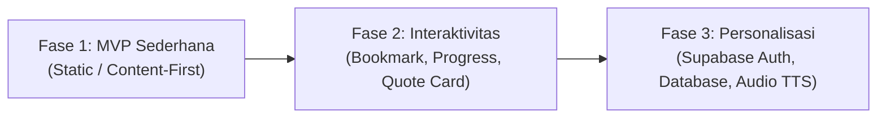

# Implementation Plan: Web Ringkasan Buku (ringkasnya.id)

Dokumen ini berisi rancangan pengembangan website **ringkasnya.id** menggunakan pendekatan **ATM (Amati, Tiru, Modifikasi)** terhadap platform ringkasan buku populer (*Headway*, *Booksnap*, dan *ringkaspaham.id*). Pengembangan dirancang bertahap (iteratif) mulai dari versi MVP (sederhana & cepat rilis) hingga versi lanjutan (lengkap & interaktif).

---

## 1. Analisis ATM (Amati, Tiru, Modifikasi)

```
[ Headway / Blinkist ]       [ ringkaspaham.id ]          [ Booksnap ]
- Format bab ringkas        - Relevansi audiens lokal    - Visual key-takeaway
- Reader view rapi          - Bahasa santai & mudah      - Shareable quote cards
- Estimasi waktu baca         dipahami
         \                          |                          /
          \                         |                         /
           +------------------------+------------------------+
                                    |
                           [ ringkasnya.id ]
                  - Clean, Mobile-First Web App (Tema Hijau Emerald)
                  - Kurasi Buku Populer (Bahasa Indonesia)
                  - "Mode Kilat (6–10 Menit)" + "Mode Mendalam (20–30 Menit)"
                  - Actionable Checklist (Penerapan praktis)
                  - Shareable Quote Cards untuk Medsos
```

### Amati (Observasi Referensi)
- **Headway & Blinkist**: Navigasi bab per bab yang ringkas (*flashcard-like reader*), penekanan pada durasi baca terukur, serta pengalaman membaca mobile yang minim distraksi.
- **ringkaspaham.id**: Mengadaptasi buku-buku *best-seller* dunia ke dalam bahasa Indonesia yang luwes, kontekstual, dan mudah dicerna untuk audiens lokal.
- **Booksnap**: Penekanan pada visual grafis, quote ringkas, dan ringkasan yang mudah dibagikan (*shareable*).

### Tiru (Fitur Fondasi yang Diadaptasi)
1. **Struktur Konten Terstandar**:
   - Metadata Buku: Judul, Penulis, Kategori, Estimasi Waktu Baca, Cover (basis hijau emerald), Skor Rekomendasi.
   - *Who Is This For*: Target pembaca ideal untuk buku tersebut.
   - *Key Insights / Bab Ringkas*: 7–8 poin utama yang diuraikan secara lugas.
   - *Final Takeaway / Kesimpulan*: Inti pati dari keseluruhan buku.
2. **Katalog & Navigasi**: Halaman beranda dengan kurasi buku terpopuler, filter kategori, kolom pencarian instan, serta smooth scroll & transisi halaman.
3. **Reader Mode Nyaman**: Tipografi ramah mata, pemisah bab jelas, pengaturan ukuran huruf, dan animasi transisi mode baca.

### Modifikasi (Nilai Tambah / UVP ringkasnya.id)
1. **Mode Ringkasan Dwi-Kecepatan (Terukur ~200 kata/menit)**:
   - *Mode Kilat (6–10 Menit)*: ~1.350–1.750 kata berisi sinopsis, poin inti 1–3 kalimat, tips praktis, checklist, kutipan, dan kesimpulan.
   - *Mode Mendalam (20–30 Menit)*: ~4.150–5.500 kata dengan penjelasan komprehensif 4–5 paragraf per poin/bab, contoh kasus, dan penerapan praktis.
2. **Action Checklist (Praktek Nyata)**: Daftar aksi praktis di akhir ringkasan dengan kotak centang (*checklist*) interaktif (tersimpan di `localStorage`) agar pembaca bisa langsung mempraktikkan isi buku.
3. **Social Quote Card**: Kartu kutipan (*quote card*) yang mudah disalin dalam 1 klik.

---

## 2. Roadmap Pengembangan Bertahap (Phased Rollout)



### Fase 1: MVP Sederhana (Terealisasi)
- **Tujuan**: Memiliki web hidup dan siap diakses pembaca dengan konten berbobot tanpa beban pengelolaan database rumit.
- **Tech Stack**: Next.js 15 (App Router, SSG, TypeScript) + Tailwind CSS + `lucide-react` + Data Lokal Modular (`src/data/books/*.ts`).
- **Fitur Fase 1**:
  - Landing page bersih dengan Hero section, kurasi 6 buku populer, filter kategori, dan pencarian instan.
  - Halaman Detail & Reader View (`/buku/[slug]`) dengan toggle **Mode Kilat (6–10 Menit)** vs **Mode Mendalam (20–30 Menit)**, pengatur ukuran huruf, dan *Action Checklist* interaktif (`localStorage`).
  - Identitas visual tema hijau emerald (`emerald-800` / `emerald-700` / `teal-700`) agar teks putih selalu kontras, ditambah favicon SVG (`src/app/icon.svg`) dan konfigurasi Vercel (`vercel.json`).
  - Navigasi halus menggunakan `SmoothNavigation.tsx` (`SmoothHashLink` berbasis `requestAnimationFrame` + `PageTransitionWrapper`).
  - 6 ringkasan buku *best-seller* lengkap dalam Bahasa Indonesia: *Atomic Habits*, *The Psychology of Money*, *Deep Work*, *Show Your Work!*, *Filosofi Teras*, dan *Essentialism*.

### Fase 2: Peningkatan Interaktivitas (Selanjutnya)
- Fitur simpan/bookmark buku favorit (`localStorage`).
- Indikator progress membaca (*reading progress bar*) di Reader View.
- Generator kartu kutipan estetik (*Shareable Quote Card* ke gambar PNG).
- Pengujian UI otomatis dengan Playwright.

### Fase 3: Fitur Komunitas & Lanjutan
- Sistem Akun & Login + Database (Supabase / PostgreSQL — integrasi Vercel↔Supabase env vars sudah tersedia).
- Ringkasan Audio (Text-to-Speech / Narasi Audio singkat).
- Halaman Admin CMS untuk tambah/edit ringkasan buku langsung dari browser.

---

## 3. Arsitektur & Struktur File (Fase 1 di `E:\MyApp\ringkasnya`)

### Konfigurasi & Aset
- `package.json`, `tsconfig.json`, `next.config.ts`, `postcss.config.mjs`, `tailwind.config.ts`, `vercel.json`
- `src/app/icon.svg`: Favicon SVG bertema hijau emerald.

### Struktur Data & Konten Buku Modular
- `src/types/book.ts`: Interface `BookCategory`, `BookTakeaway`, dan `BookSummary`.
- `src/data/books.ts`: Menggabungkan dan mengekspor `CATEGORIES`, `BOOKS`, serta `getBookBySlug(slug)`.
- `src/data/books/*.ts`: 6 modul buku terpisah (`atomic-habits.ts`, `psychology-of-money.ts`, `deep-work.ts`, `show-your-work.ts`, `filosofi-teras.ts`, `essentialism.ts`) dengan panjang teks sesuai target 6–10 menit (Kilat) dan 20–30 menit (Mendalam).

### Halaman & Komponen UI
- `src/app/layout.tsx` & `src/app/globals.css`: Layout root dengan `SmoothScrollHandler`, `PageTransitionWrapper`, dan animasi `pageEnter` / `fadeSlideUp`.
- `src/components/SmoothNavigation.tsx`: Komponen `SmoothHashLink`, `SmoothScrollHandler`, dan `PageTransitionWrapper` untuk smooth scroll & transisi antar halaman.
- `src/components/Navbar.tsx` & `Footer.tsx`: Navigasi responsif dengan branding **ringkasnya.id** ("Baca Intinya, Praktikkan Ilmunya").
- `src/components/BookCard.tsx` & `CatalogSection.tsx`: Kartu buku bertema hijau emerald, filter kategori, dan pencarian instan.
- `src/app/page.tsx`: Halaman Utama (Hero, Katalog Buku, Seksi Metode Membaca).
- `src/app/buku/[slug]/page.tsx` & `src/components/BookReader.tsx`: Reader View interaktif dengan toggle Mode Kilat/Mendalam, kontrol font, Action Checklist, dan salin kutipan.
