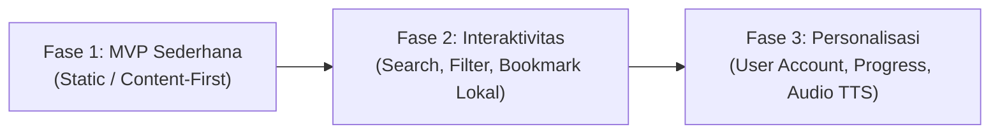

# Implementation Plan: Web Ringkasan Buku (ringkasnya.id)

Dokumen ini berisi rancangan pengembangan website **ringkasnya.id** menggunakan pendekatan **ATM (Amati, Tiru, Modifikasi)** terhadap platform ringkasan buku populer (*Headway*, *Booksnap*, dan *ringkaspaham.id*). Pengembangan dirancang bertahap (iteratif) mulai dari versi MVP (sederhana & cepat rilis) hingga versi lanjutan (lengkap & interaktif).

---

## 1. Analisis ATM (Amati, Tiru, Modifikasi)

```
[ Headway / Blinkist ]       [ ringkaspaham.id ]          [ Booksnap ]
- Format bab ringkas        - Relevansi audiens lokal    - Visual key-takeaway
- Reader view rapi          - Bahasa santai & mudah      - Shareable quote cards
- Estimasi waktu baca         dipahami
         \                          |                          /
          \                         |                         /
           +------------------------+------------------------+
                                    |
                           [ ringkasnya.id ]
                  - Clean, Mobile-First Web App
                  - Kurasi Buku Populer (Bahasa Indonesia)
                  - "3-Min Quick Glance" + "10-Min In-Depth"
                  - Actionable Checklist (Penerapan praktis)
                  - Shareable Quote Cards untuk Medsos
```

### Amati (Observasi Referensi)
- **Headway & Blinkist**: Navigasi bab per bab yang ringkas (*flashcard-like reader*), penekanan pada durasi baca (misal: "8 min read"), serta pengalaman membaca mobile yang sangat minim distraksi.
- **ringkaspaham.id**: Mengadaptasi buku-buku *best-seller* dunia ke dalam bahasa Indonesia yang luwes, kontekstual, dan mudah dicerna untuk audiens lokal.
- **Booksnap**: Penekanan pada visual grafis, quote ringkas, dan ringkasan yang mudah dibagikan (*shareable*).

### Tiru (Fitur Fondasi yang Diadaptasi)
1. **Struktur Konten Terstandar**:
   - Metadata Buku: Judul, Penulis, Kategori, Estimasi Waktu Baca, Cover, Skor Rekomendasi.
   - *Who Is This For*: Target pembaca ideal untuk buku tersebut.
   - *Key Insights / Bab Ringkas*: 3–7 poin utama yang diuraikan secara lugas.
   - *Final Takeaway / Kesimpulan*: Inti pati dari keseluruhan buku.
2. **Katalog & Navigasi**: Halaman beranda dengan rekomendasi buku terpopuler, filter kategori (Produktivitas, Bisnis, Keuangan, Psikologi, Self-Development), dan kolom pencarian instan.
3. **Reader Mode Nyaman**: Tipografi ramah mata, pemisah bab jelas, serta pengaturan ukuran huruf.

### Modifikasi (Nilai Tambah / UVP ringkasnya.id)
1. **Mode Ringkasan Dwi-Kecepatan**:
   - *Kilat (3 Menit)*: Hanya membaca poin inti & kesimpulan utama.
   - *Mendalam (10–12 Menit)*: Penjelasan komprehensif per poin/bab.
2. **Action Checklist (Praktek Nyata)**: Daftar aksi praktis di akhir ringkasan dengan kotak centang (*checklist*) interaktif (tersimpan di `localStorage`) agar pembaca bisa langsung mempraktikkan isi buku.
3. **Social Quote Card**: Kartu kutipan (*quote card*) berdesain estetik yang mudah disalin atau dibagikan.

---

## 2. Roadmap Pengembangan Bertahap (Phased Rollout)



### Fase 1: MVP Sederhana (Fokus Saat Ini)
- **Tujuan**: Memiliki web hidup dan siap diakses pembaca dalam waktu singkat tanpa beban pengelolaan database rumit.
- **Tech Stack**: Next.js (App Router, TypeScript) + Tailwind CSS + Markdown/Data Lokal.
- **Fitur Fase 1**:
  - Landing page bersih dengan Hero section, kurasi buku populer, dan filter kategori.
  - Halaman Detail & Reader View (`/buku/[slug]`) dengan fitur *Mode Kilat (3 Menit)* vs *Mode Mendalam (10 Menit)*.
  - *Action Checklist* interaktif di akhir setiap ringkasan buku.
  - 4 ringkasan buku *best-seller* awal lengkap dalam Bahasa Indonesia (*Atomic Habits*, *The Psychology of Money*, *Deep Work*, *Show Your Work!*).

### Fase 2: Peningkatan Interaktivitas (Selanjutnya)
- Fitur pencarian cepat (*instant search*) dan filter multi-kategori.
- Fitur simpan/bookmark buku favorit (`localStorage`).
- Indikator progress membaca (*reading progress bar*) & kontrol ukuran font di Reader View.
- Generator kartu kutipan estetik (*Shareable Quote Card* ke gambar PNG).

### Fase 3: Fitur Komunitas & Lanjutan
- Sistem Akun & Login + Database (Supabase / PostgreSQL).
- Ringkasan Audio (Text-to-Speech / Narasi Audio singkat).
- Halaman Admin CMS untuk tambah/edit ringkasan buku langsung dari browser.

---

## 3. Proposed Changes (Fase 1: Setup & MVP di `E:\MyApp\ringkasnya`)

### Inisialisasi Proyek & Konfigurasi
#### [NEW] `E:\MyApp\ringkasnya\package.json`, `tsconfig.json`, `next.config.ts`, `postcss.config.mjs`
- Setup Next.js App Router dengan TypeScript, Tailwind CSS, dan `lucide-react` untuk ikon.

---

### Struktur Data & Konten Buku
#### [NEW] `E:\MyApp\ringkasnya\src\types\book.ts`
```typescript
export interface BookTakeaway {
  number: number;
  title: string;
  quickSummary: string; // Untuk Mode Kilat (3 menit)
  deepContent: string[]; // Paragraf penjelasan untuk Mode Mendalam (10 menit)
}

export interface BookSummary {
  slug: string;
  title: string;
  author: string;
  category: 'Kebiasaan & Produktivitas' | 'Keuangan & Bisnis' | 'Psikologi' | 'Kreativitas & Karier';
  readingTimeMinutes: number;
  QuickTimeMinutes: number;
  coverColor: string;
  coverAccent: string;
  tagline: string;
  synopsis: string;
  whoIsItFor: string[];
  keyTakeaways: BookTakeaway[];
  actionChecklist: string[];
  quotes: string[];
  conclusion: string;
}
```

#### [NEW] `E:\MyApp\ringkasnya\src\data\books.ts` (dan loader Markdown `content/books/*.md`)
- Berisi data ringkasan buku awal dalam Bahasa Indonesia yang natural dan aplikatif:
  1. **Atomic Habits** – James Clear
  2. **The Psychology of Money** – Morgan Housel
  3. **Deep Work** – Cal Newport
  4. **Show Your Work!** – Austin Kleon

---

### Halaman & Komponen UI
#### [NEW] `E:\MyApp\ringkasnya\src\components\Navbar.tsx` & `Footer.tsx`
- Navigasi responsif dengan branding **ringkasnya.id** ("Baca Intinya, Praktikkan Ilmunya").

#### [NEW] `E:\MyApp\ringkasnya\src\components\BookCard.tsx`
- Kartu katalog buku dengan visual sampul buku bergaya modern, badge kategori, waktu baca, judul, penulis, dan tagline singkat.

#### [NEW] `E:\MyApp\ringkasnya\src\app\page.tsx`
- Halaman Utama (Home):
  - Hero Section dengan proposisi nilai *ringkasnya.id*.
  - Filter kategori buku & pencarian kata kunci.
  - Grid daftar ringkasan buku pilihan.
  - Bagian penjelasan metode membaca di *ringkasnya.id* (Kilat 3 Menit, Mendalam 10 Menit, Action Checklist).

#### [NEW] `E:\MyApp\ringkasnya\src\app\buku\[slug]\page.tsx` & `ReaderClient.tsx`
- Halaman Baca Ringkasan Buku (*Reader View*):
  - Header detail buku, target pembaca (*Cocok untuk siapa?*), dan sinopsis singkat.
  - Toggle **Mode Kilat (3 Menit)** vs **Mode Mendalam (10 Menit)**.
  - Daftar *Key Takeaways* (Poin Inti Bab per Bab).
  - Komponen **Action Checklist** interaktif (tersimpan otomatis di browser pembaca).
  - Kartu Kutipan Pilihan (*Quotes*) dengan tombol *Salin Kutipan*.

---

## 4. Verification Plan

### Automated Verification
- Menjalankan `npm run build` di `E:\MyApp\ringkasnya` untuk memastikan kompilasi TypeScript dan Next.js berjalan tanpa error.

### Manual Verification
1. Menjalankan `npm run dev` dan membuka `http://localhost:3000`.
2. Memastikan halaman beranda menampilkan daftar buku, filter kategori berfungsi, dan pencarian bekerja.
3. Membuka halaman detail buku (`/buku/atomic-habits`), menguji toggle **Mode Kilat** vs **Mode Mendalam**, serta mencentang **Action Checklist** dan menyalin kutipan.
