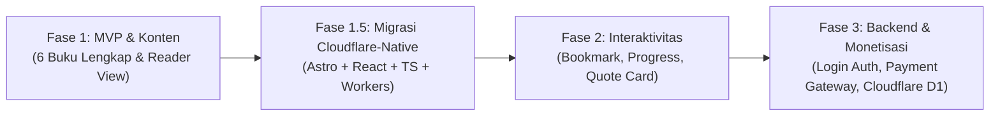

# Implementation Plan: Web Ringkasan Buku (ringkasnya.id)

Dokumen ini berisi rancangan pengembangan website **ringkasnya.id** menggunakan pendekatan **ATM (Amati, Tiru, Modifikasi)** terhadap platform ringkasan buku populer (*Headway*, *Booksnap*, dan *ringkaspaham.id*), serta rencana migrasi arsitektur ke **Cloudflare-Native Stack (Astro 5 + React + TypeScript + `@astrojs/cloudflare`)** yang siap mendukung fitur backend (Login & Pembayaran).

---

## 1. Analisis ATM (Amati, Tiru, Modifikasi)

```
[ Headway / Blinkist ]       [ ringkaspaham.id ]          [ Booksnap ]
- Format bab ringkas        - Relevansi audiens lokal    - Visual key-takeaway
- Reader view rapi          - Bahasa santai & mudah      - Shareable quote cards
- Estimasi waktu baca         dipahami
         \                          |                          /
          \                         |                         /
           +------------------------+------------------------+
                                    |
                           [ ringkasnya.id ]
                  - Clean, Mobile-First Web App (Tema Hijau Emerald)
                  - Kurasi Buku Populer (Bahasa Indonesia)
                  - "Mode Kilat (6–10 Menit)" + "Mode Mendalam (20–30 Menit)"
                  - Actionable Checklist (Penerapan praktis)
                  - Shareable Quote Cards untuk Medsos
```

### Amati (Observasi Referensi)
- **Headway & Blinkist**: Navigasi bab per bab yang ringkas (*flashcard-like reader*), penekanan pada durasi baca terukur, serta pengalaman membaca mobile yang minim distraksi.
- **ringkaspaham.id**: Mengadaptasi buku-buku *best-seller* dunia ke dalam bahasa Indonesia yang luwes, kontekstual, dan mudah dicerna untuk audiens lokal.
- **Booksnap**: Penekanan pada visual grafis, quote ringkas, dan ringkasan yang mudah dibagikan (*shareable*).

### Tiru (Fitur Fondasi yang Diadaptasi)
1. **Struktur Konten Terstandar**:
   - Metadata Buku: Judul, Penulis, Kategori, Estimasi Waktu Baca, Cover (basis hijau emerald), Skor Rekomendasi.
   - *Who Is This For*: Target pembaca ideal untuk buku tersebut.
   - *Key Insights / Bab Ringkas*: 7–8 poin utama yang diuraikan secara lugas.
   - *Final Takeaway / Kesimpulan*: Inti pati dari keseluruhan buku.
2. **Katalog & Navigasi**: Halaman beranda dengan kurasi buku terpopuler, filter kategori, kolom pencarian instan, serta smooth scroll & transisi halaman.
3. **Reader Mode Nyaman**: Tipografi ramah mata, pemisah bab jelas, pengaturan ukuran huruf, dan animasi transisi mode baca.

### Modifikasi (Nilai Tambah / UVP ringkasnya.id)
1. **Mode Ringkasan Dwi-Kecepatan (Terukur ~200 kata/menit)**:
   - *Mode Kilat (6–10 Menit)*: ~1.350–1.750 kata berisi sinopsis, poin inti 1–3 kalimat, tips praktis, checklist, kutipan, dan kesimpulan.
   - *Mode Mendalam (20–30 Menit)*: ~4.150–5.500 kata dengan penjelasan komprehensif 4–5 paragraf per poin/bab, contoh kasus, dan penerapan praktis.
2. **Action Checklist (Praktek Nyata)**: Daftar aksi praktis di akhir ringkasan dengan kotak centang (*checklist*) interaktif (tersimpan di `localStorage`) agar pembaca bisa langsung mempraktikkan isi buku.
3. **Social Quote Card**: Kartu kutipan (*quote card*) yang mudah disalin dalam 1 klik.

---

## 2. Roadmap Pengembangan Bertahap (Phased Rollout)



### Fase 1: MVP Sederhana (Terealisasi)
- Landing page bersih dengan Hero section, kurasi 6 buku populer, filter kategori, dan pencarian instan.
- Halaman Detail & Reader View (`/buku/[slug]`) dengan toggle **Mode Kilat (6–10 Menit)** vs **Mode Mendalam (20–30 Menit)**, pengatur ukuran huruf, dan *Action Checklist* interaktif (`localStorage`).
- Identitas visual tema hijau emerald (`emerald-800`–`950`) dengan ilustrasi sampul vektor `.svg` (`public/images/covers/*.svg`).
- Navigasi halus menggunakan `SmoothNavigation.tsx` (`SmoothHashLink` + `PageTransitionWrapper`).
- 6 ringkasan buku *best-seller* lengkap dalam Bahasa Indonesia: *Atomic Habits*, *The Psychology of Money*, *Deep Work*, *Show Your Work!*, *Filosofi Teras*, dan *Essentialism*.

### Fase 1.5: Migrasi ke Cloudflare-Native Stack (Target Saat Ini)
- **Tujuan**: Memindahkan deployment dari Vercel ke **Cloudflare (Pages / Workers)** dengan mengganti engine Next.js menjadi **Astro 5 + React 19 + TypeScript + Tailwind CSS + `@astrojs/cloudflare`**.
- **Keunggulan**:
  1. **100% Native di Cloudflare & Windows**: Menggunakan Vite + `@astrojs/cloudflare` + `wrangler`, lancar dijalankan di Windows PowerShell tanpa masalah kompatibilitas `@opennextjs/cloudflare`.
  2. **Hybrid Rendering (Static + On-Demand SSR)**: Halaman publik di-prerender statis di Edge CDN, sedangkan route backend (`/api/*`) atau halaman premium berjalan di Cloudflare Workers dengan akses langsung ke database **Cloudflare D1** & **KV**.
  3. **Zero Content Rewrite**: Seluruh komponen React (`BookReader.tsx`, `CatalogSection.tsx`, `BookCard.tsx`, `Navbar.tsx`, `Footer.tsx`, `SmoothNavigation.tsx`) dan data buku (`src/data/books/*.ts`) tetap dipakai 100%.

### Fase 2: Peningkatan Interaktivitas
- Fitur simpan/bookmark buku favorit.
- Indikator progress membaca (*reading progress bar*) di Reader View.
- Generator kartu kutipan estetik (*Shareable Quote Card* ke gambar PNG).
- Pengujian UI otomatis dengan Playwright.

### Fase 3: Backend, Login & Pembayaran (Cloudflare D1 + Workers SSR)
- **Autentikasi & Manajemen Sesi**: Login pengguna (Email / Google OAuth) menggunakan **Better Auth** atau **Lucia** di atas **Cloudflare D1** (SQLite di Edge) & **Cloudflare KV**.
- **Integrasi Payment Gateway**: Endpoint webhook pembayaran (`/api/payment/webhook` untuk Midtrans / Xendit / Mayar) guna membuka akses ringkasan buku premium secara real-time.
- **Proteksi Konten Server-Side (SSR)**: Pengecekan status langganan langsung di Cloudflare Worker sebelum mengirimkan konten penuh buku premium ke browser.

---

## 3. Rencana Teknis Migrasi ke Astro + React + Cloudflare

### A. Konfigurasi Proyek & Cloudflare
- **`package.json`**: Mengganti `next` dengan `astro`, `@astrojs/react`, `@astrojs/tailwind`, `@astrojs/cloudflare`, dan `wrangler`.
- **`astro.config.mjs`**: Mengaktifkan integrasi `react()`, `tailwind()`, dan adapter `cloudflare()` dengan mode hybrid (default statis, mendukung `export const prerender = false` untuk SSR/API).
- **`wrangler.jsonc`**: Konfigurasi deployment Cloudflare Pages/Workers (`dist`), lengkap dengan persiapan binding `D1` dan `KV`.
- **`tsconfig.json` & `src/env.d.ts`**: Konfigurasi TypeScript Astro strict + path alias `@/* -> ./src/*` + tipe runtime Cloudflare.
- Menghapus `next.config.ts` dan `vercel.json`.

### B. Struktur Layout, Halaman & API (`src/layouts` & `src/pages`)
- **`src/layouts/BaseLayout.astro`**: Layout utama HTML (`lang="id"`), SEO metadata, favicon `/icon.svg`, `SmoothScrollHandler`, `Navbar`, `PageTransitionWrapper`, dan `Footer`.
- **`src/pages/index.astro`**: Halaman Beranda (Hero, `<CatalogSection client:load books={BOOKS} />`, dan Seksi Metode Membaca).
- **`src/pages/buku/[slug].astro`**: Halaman Detail & Reader View menggunakan `getStaticPaths()` dan `<BookReader client:load book={book} relatedBooks={relatedBooks} />`.
- **`src/pages/404.astro`**: Halaman 404 kustom bertema hijau emerald.
- **`src/pages/api/health.ts`**: Endpoint API Server-Side (`prerender = false`) di atas Cloudflare Workers runtime sebagai fondasi untuk `/api/auth/*` dan `/api/payment/*`.

### C. Komponen React & Navigasi Smooth
- **`src/components/SmoothNavigation.tsx`**: Mengganti `usePathname`/`useRouter` dari `next/navigation` menjadi Web Standard Navigation (`window.location` & history/navigation) agar `SmoothHashLink`, `SmoothScrollHandler`, dan `PageTransitionWrapper` tetap bekerja mulus.
- **`src/components/Navbar.tsx`, `Footer.tsx`, `BookCard.tsx`, `BookReader.tsx`**: Mengganti `next/link` dengan elemen `<a>` standar yang diintersepsi secara mulus oleh `PageTransitionWrapper`.
